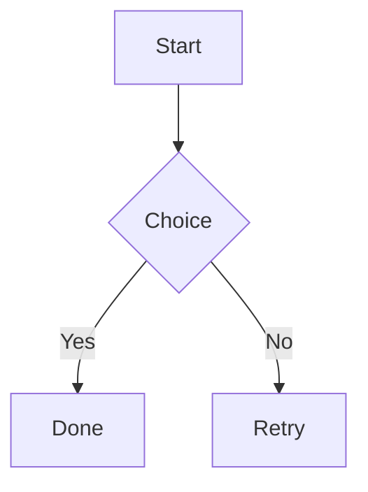
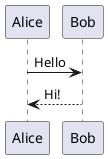

# JetBrains → VS Code: Quick Checklists

## Foundation (Keymaps & Core Behavior)
- [ ] Extensions (`Ctrl+Shift+X`): Install "IntelliJ IDEA Keybindings" (Keisuke Terada)
- [ ] Verify shortcuts: `Ctrl+Y` delete line, `Ctrl+W` expand selection
- [ ] Settings (`Ctrl+,`): Auto Save → `onFocusChange`

## UI & Preview
- [ ] Sidebar: ensure Activity Bar visible; move sidebar right if desired
- [ ] Markdown preview: `Ctrl+Shift+V` or "Markdown: Open Preview to the Side"
- [ ] Mermaid: install "Markdown Preview Mermaid Support"; preview fenced ```mermaid blocks
- [ ] PlantUML: install "PlantUML" (jebbs); preview fenced ```plantuml blocks or `.puml`
- [ ] Linux prerequisite for PlantUML: install Graphviz

```zsh
# Debian/Ubuntu
sudo apt-get update
sudo apt-get install -y graphviz

# Fedora
sudo dnf install -y graphviz
```

## Python
- [ ] Install "Python" (Microsoft) and Pylance
- [ ] `Ctrl+Shift+P` → "Python: Select Interpreter" → choose project `.venv`/virtualenv


## GitHub Integration
- [ ] Install "GitLens" (GitKraken)
- [ ] Install "GitHub Pull Requests" (GitHub)
- [ ] Install "GitHub Actions" (GitHub)
- [ ] Install "GitHub Markdown Preview" (Matt Bierner)

## Agentic AI
- [ ] Install "GitHub Copilot" and "GitHub Copilot Chat"
- [ ] Use Inline Chat `Ctrl+I` for in-editor assistance


## Quick Examples (Diagrams)




## Migration Summary
- [ ] Install VS Code (or Cursor)
- [ ] IntelliJ keybindings installed
- [ ] Auto Save set
- [ ] Python + interpreter configured
- [ ] Biome configured
- [ ] Markdown/Mermaid/PlantUML preview working
- [ ] Verify key shortcuts: `Ctrl+W`, `Ctrl+Y`, `Ctrl+B`, `Shift+Shift`